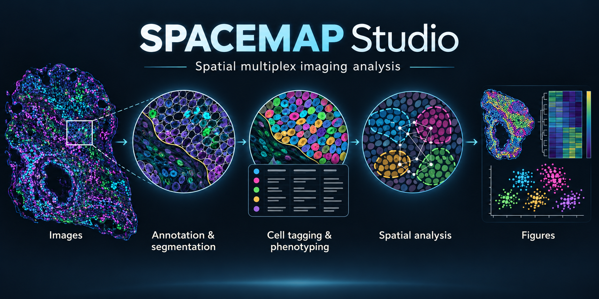

# SPACEMAP Studio

**Spatial multiplex imaging analysis, from images to interpretable spatial results.**



*Conceptual workflow illustration; the tissue and charts are synthetic, not research results.*

[](https://github.com/AguileraLab/SPACEMAP/actions/workflows/ci.yml)
[](https://www.python.org/)
[](LICENSE)

**Studio** brings the pipeline, image viewer, cell table, figures and background
jobs into one browser workspace. Review an image, adjust annotations, inspect
cell identities and run analyses without losing your place. The classic
SPACEMAP interface, Python modules and notebooks remain available.

## Get started

```bash
git clone https://github.com/AguileraLab/SPACEMAP.git
cd SPACEMAP
conda env create -f environment.yml
conda activate spacemap
spacemap doctor
spacemap
```

Open the address printed in the terminal (normally <http://localhost:8501>).
Create or open a project in **Project Workspace**, then click **SPACEMAP Studio**
in the top bar. Use **Classic SPACEMAP** to return to the tabbed interface.

The environment uses **Python 3.10**, includes JupyterLab and keeps AI packages
optional. A GPU is useful for segmentation but is not required to open Studio
or run CPU analyses. Images and custom model weights are separate from this
software repository.

See [Your first project](docs/first-project.md) and
[Installation](docs/installation.md) for data setup, pip, Docker and GPU details.

## What Studio adds

- **An integrated image workspace:** full-resolution navigation, marker contrast,
  H&E overlays, cell outlines, annotation layers and linked figures.
- **Interactive review:** draw and correct polygons, assign manual cell labels,
  inspect phenotype disagreements and edit cell-table values and columns.
- **Reusable models:** train Cellpose from existing models; use manual-reference
  models or reference-weighted phenotyping for cohort prediction.
- **Background analysis:** saved job results, independent elapsed timers,
  informative progress and safe stopping for supported compute workers.
- **Spatial exploration:** neighbourhoods, interactions, density, triads and
  reviewable **TLS candidates**, including structure boundaries and signed distances.
- **Shared project formats:** Studio and the classic tools use the same project
  settings, images and tables. Choose CPU workers and supported GPU backends in
  the relevant step.

TLS candidates are exploratory lymphoid aggregates that require biological
review; detecting a candidate is not a diagnosis of a mature TLS. GPU support
is backend-specific: gap-aware cell-tagging visibility runs on CPU, and an
optional GPU random forest uses different split calculations from the CPU model.

## The pipeline

Studio has a dedicated Cell tagging step. Classic tab numbers remain unchanged.

| Studio step | Classic tab | Purpose |
| --- | --- | --- |
| 0 · Project | 0 | Project files, input/output folders and optional AI setup |
| 1 · Registration | 1 | Align multiplex images and matching H&E |
| 2 · Background | 2 | Detect background and correct marker images |
| 3 · Regions of interest | 3 | Draw, import and extract tissue regions |
| 4 · Annotation | 4 | Define and review tissue compartments and zones |
| 5 · Segmentation | 5 | Cellpose segmentation, model training and cell measurements |
| 6 · Cell tagging | 5 | Annotation membership, tissue pieces, areas, distances and beds |
| 7 · Batch correction | 6 | Combine tables and correct marker batch effects |
| 8 · Phenotyping | 7 | Thresholds, Leiden, SOM, VORTEX, SCIMAP, consensus and manual-reference ML |
| 9 · Spatial analysis | 8 | Neighbourhoods, interactions, density and TLS candidates |
| 10 · Visualization | 9 | Maps, heatmaps and exported figures |

Start at the stage matching your existing inputs. Confirm image/channel names,
cell IDs, annotation alignment and micrometres per pixel before analysing a
cohort. Test a small image first.

## Projects and jobs

Keep study projects **outside the software checkout**. Each project has its own
configuration and `outputs/` tree; each step shows its input and output folders.
Settings, application caches and downloaded models normally live under
`~/.spacemap`. You can choose other locations:

```bash
export SPACEMAP_HOME=/path/to/application-state
export SPACEMAP_MODELS_DIR=/path/to/models
```

Studio allows **one active background job per project**, including across
computers sharing the same storage. For a concurrent test, use a separate
project folder with independent configuration, job history and outputs. Input
images and cell tables can be shared for reading; changing only an output
folder does not create a separate project.

## Optional AI assistant

The assistant is off by default and the analysis workflow works without it.
Install `python -m pip install -e ".[ai]"` and open **AI setup** to configure a
local model. Model weights are downloaded separately; CPU and GPU requirements
vary by model. Downloads and explicitly enabled online tools require network
access. See [AI assistant](docs/ai-assistant.md) for configuration and privacy.

Set `SPACEMAP_ASSISTANT=off` to disable it for an installation.

## Python and notebooks

The `spacemap` package exposes the scientific modules for scripts. The
`notebooks/` directory contains step-by-step workflows; configure their data
paths before running. Notebook outputs are stripped from the repository.

## Documentation and development

| Guide | Contents |
| --- | --- |
| [First project](docs/first-project.md) | Inputs, calibration and stage-by-stage setup |
| [Installation](docs/installation.md) | Environment, Docker, GPU setup and troubleshooting |
| [Studio](docs/studio-guide.md) | Viewer, tables, annotations, jobs and interpretation |
| [Troubleshooting](docs/troubleshooting.md) | Common failures and fixes |
| [Architecture](docs/architecture.md) | Packages and optional services |
| [Studio release](docs/studio-release.md) | Release checks and publishing this version |
| [Contributing](CONTRIBUTING.md) | Development and review conventions |
| [Changelog](CHANGELOG.md) | Changes for users |

```bash
python -m pip install --upgrade pip
python -m pip install -e . --group dev
python -m pip check
python -m ruff check src scripts
python scripts/check_no_local_paths.py
python -m pytest
```

The default test suite uses synthetic inputs. GPU, browser, container and
full-dataset checks are recorded separately; passing unit tests alone does not
validate a study's biological conclusions. See the release guide for the
validation scope.

## Citation and license

Use [CITATION.cff](CITATION.cff) to cite SPACEMAP, and record the software version
or commit, analysis settings and input data version with published results.

SPACEMAP retains the repository's **[academic research use only license](LICENSE)**,
© The University of Texas Southwestern Medical Center. Dependencies and model
weights have their own licenses and terms.
